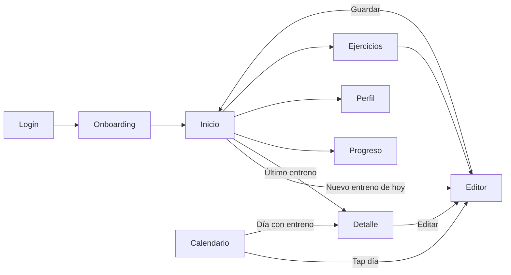

# SPEC — App de registro de entrenos de gimnasio (nombre provisional: **Entrenos**)

**Versión:** v1 aprobada · **Aprobación:** `spec aprobado` el 2026-11-20 · **Idioma:** español (es-ES) · **Unidades:** métrico

## 1. Visión y objetivos

App web personal, mobile-first, para registrar entrenos de gimnasio en el menor número de toques posible, desde el móvil y en el gimnasio. Los datos son privados de un único usuario, se persisten en Supabase y se consultan desde cualquier dispositivo. El objetivo es responder tres preguntas rápido: *¿qué hice ayer?*, *¿cuánto quemé?* y *¿estoy progresando?*.

**Objetivos**
- Registrar una serie nueva en ≤ 3 toques desde la pantalla de entreno.
- Calcular calorías automáticamente con una fórmula transparente y editable.
- Consultar el histórico por calendario, incluidas fechas pasadas.
- Ver progreso de carga, peso corporal y volumen de entrenamiento con gráficas legibles en móvil.

**Non-goals (fuera de alcance)**
- App nativa / PWA instalable con sincronización offline (sin `localStorage` como persistencia principal; solo estado en memoria durante la sesión).
- Generación de planes/rutinas automáticas, IA, recomendaciones de entrenamiento.
- Integraciones con Apple Health, Google Fit, Strava, GPS o wearables.
- Social: compartir, comparar con otros usuarios, comunidades, roles multiusuario.
- Consejo médico o nutricional; todas las fórmulas son orientativas.
- Cambio de email/contraseña desde la app (se delega a Supabase Auth).
- Edición de MET del catálogo por el usuario en v1 (ver §14).
- Modo oscuro con selector propio en v1 (se respeta la preferencia del sistema; §14).

## 2. Usuarios y casos de uso

**Actor único:** el propietario de la cuenta. No hay perfiles públicos ni administradores.

| ID | Caso de uso |
|---|---|
| CU-01 | Actualizar mi peso y ver mi evolución. |
| CU-02 | Consultar mi IMC y mi peso ideal orientativo. |
| CU-03 | Buscar un ejercicio en mi catálogo o crearlo nuevo. |
| CU-04 | Registrar un entreno con varios ejercicios y varias series por ejercicio. |
| CU-05 | Aceptar, editar o restablecer las calorías estimadas. |
| CU-06 | Abrir el calendario y registrar/editar el entreno de cualquier día, incluido uno pasado. |
| CU-07 | Revisar mis últimos entrenos y el detalle de cada ejercicio. |
| CU-08 | Ver estadísticas con un filtro de rango de fechas. |

## 3. Historias de usuario y criterios de aceptación

**HU-01 — Perfil y peso (RF-01, RF-02, RF-03)**
- **Dado** que soy usuario nuevo, **cuando** completo el onboarding, **entonces** mi perfil guarda nombre, sexo, fecha de nacimiento y altura; el peso objetivo queda opcional.
- **Dado** que registro 70,0 kg hoy y 69,4 kg una semana después, **cuando** abro mi perfil, **entonces** el "peso actual" es 69,4 kg y el historial muestra ambas mediciones con su fecha.
- **Dado** que repito medición en la misma fecha, **cuando** guardo, **entonces** se actualiza esa fila (UPSERT) y no se crea una duplicada.

**HU-02 — IMC y peso ideal (RF-04, RF-05)**
- **Dado** 70 kg y 175 cm, **cuando** abro mi perfil, **entonces** veo IMC 22,9 y categoría "Normal", peso Devine ≈ 58,0 kg y rango IMC 56,7–76,3 kg, con una explicación breve.
- **Dado** que me falta la altura, **cuando** entro en la pantalla, **entonces** veo "—" y un enlace a completar datos, nunca un número inventado.

**HU-03 — Catálogo (RF-06, RF-07)**
- **Dado** que escribo "bí", **cuando** el desplegable muestra coincidencias, **entonces** aparecen ejercicios globales y míos, y puedo crear "Bíceps" si no existe.
- **Dado** que creo "Bíceps" con tipo peso, **cuando** lo seleccione en otro entreno, **entonces** el tipo de carga viene preconfigurado con "Peso (kg)".

**HU-04 — Registro rápido (RF-08, RF-09, RF-10)**
- **Dado** un entreno abierto, **cuando** añado una fila, **entonces** el foco queda en el primer campo y el valor de carga se precarga con el último usado para ese ejercicio; repeticiones/minutos quedan vacíos.
- **Dado** "Bíceps / Peso", **cuando** escribo 18 kg y 50 reps y pulso "Añadir serie", **entonces** puedo añadir otra fila de 30 kg y 25 reps sin salir de la pantalla.
- **Dado** "Bicicleta estática / Dureza", **cuando** escribo 36 y 20 minutos, **entonces** se guarda correctamente y no aparece el campo de repeticiones.

**HU-05 — Cambio de tipo de carga (RF-11)**
- **Dado** una fila con 50 reps a 18 kg, **cuando** cambio el tipo a "Dureza", **entonces** aparece un aviso de confirmación, se limpian las repeticiones, se conserva el 18 como dureza y el campo Minutos queda obligatorio vacío; no se guarda hasta rellenarlo.
- **Dado** una dureza de 120, **cuando** intento cambiar a Peso, **entonces** se bloquea el cambio con un mensaje indicando que el valor debe estar entre 0 y 100.

**HU-06 — Calorías (RF-12, RF-13, RF-14, RF-15)**
- **Dado** 70 kg, Bíceps (MET 5,0), 50 reps a 18 kg y 25 reps a 30 kg, **cuando** guardo, **entonces** se estiman 4,75 min y **27,7 kcal** (según §5).
- **Dado** que edito manualmente a 40 kcal, **cuando** añado una serie, **entonces** se recalcula solo el estimado, el valor final sigue siendo 40 y aparece el aviso "La estimación ha cambiado".
- **Dado** un valor manual, **cuando** pulso "Restablecer a estimado", **entonces** el valor final pasa a ser el estimado y se quita la marca "editado manualmente".
- **Dado** que no tengo peso registrado, **cuando** guardo un entreno, **entonces** las calorías se muestran como "—" con el mensaje "Registra tu peso para calcularlas"; la duración estimada sí se guarda.

**HU-07 — Calendario e histórico (RF-16, RF-17, RF-18, RF-19)**
- **Dado** la vista mensual, **cuando** un día tiene entreno, **entonces** se distingue visualmente (punto/relleno) y al tocarlo se abre su registro.
- **Dado** un día sin entreno, **cuando** lo toco, **entonces** se abre el formulario con esa fecha precargada (permitiendo fechas pasadas; fechas futuras se bloquean).
- **Dado** la pantalla principal, **cuando** entro, **entonces** veo los últimos entrenos con nombre, carga, reps/minutos y calorías con etiqueta "estimadas" o "editadas", y un botón "Nuevo entreno de hoy".

**HU-08 — Estadísticas (RF-20, RF-21)**
- **Dado** varios entrenos, **cuando** abro Progreso con rango "Últimos 30 días", **entonces** veo calorías por día/semana/mes, frecuencia, tiempo total, evolución del peso y progresión de carga por ejercicio, con la misma tabla de datos accesible detrás de cada gráfica.

## 4. Requisitos funcionales y no funcionales

### Funcionales

| ID | Requisito |
|---|---|
| RF-01 | Autenticación con Supabase Auth (email/contraseña) y onboarding de perfil. |
| RF-02 | Perfil: nombre, sexo, fecha de nacimiento, altura (cm), peso objetivo (opcional). |
| RF-03 | Historial de peso con fecha; "peso actual" = medición más reciente con `measured_on <= fecha_del_entreno`; UPSERT por día. |
| RF-04 | IMC con categoría (bajo peso, normal, sobrepeso, obesidad I/II/III). |
| RF-05 | Peso ideal Devine + rango saludable IMC 18,5–24,9, con explicación en pantalla. |
| RF-06 | Catálogo de ejercicios con autocompletado, creación y recuerdo del último `load_type`. |
| RF-07 | Ejercicios globales semilla (solo lectura) + ejercicios personales (CRUD). |
| RF-08 | Entreno: fecha, notas, ejercicios y series; crear, editar, borrar. |
| RF-09 | Desplegable `load_type` que conmuta el segundo campo entre Repeticiones y Minutos. |
| RF-10 | Varias series por ejercicio; añadir, editar, borrar filas y reordenar. |
| RF-11 | Reglas explícitas de conversión al cambiar `load_type` con datos ya escritos (§8). |
| RF-12 | Cálculo automático de calorías y duración al guardar o modificar el entreno. |
| RF-13 | Persistir por separado estimado y valor final, con marca y marcas de tiempo de manual/estimado. |
| RF-14 | Edición manual prevalece; aviso si la estimación cambia después; botón "Restablecer a estimado". |
| RF-15 | Sin peso corporal no hay estimación de calorías (la duración sí se calcula). |
| RF-16 | Calendario mensual con días con entreno diferenciados y apertura del registro del día. |
| RF-17 | Registro de entrenos en fechas pasadas; fechas futuras bloqueadas. |
| RF-18 | Lista de últimos entrenos con detalle por ejercicio y calorías etiquetadas. |
| RF-19 | Acceso rápido "Nuevo entreno de hoy" (un entreno por día por defecto). |
| RF-20 | Estadísticas: calorías día/semana/mes, frecuencia, peso, progresión de carga, tiempo total, filtro por rango. |
| RF-21 | Gráficas legibles en móvil con valores textuales/equivalente accesible. |
| RF-22 | Validación de datos en cliente y en base de datos (rangos, obligatorios, no negativos). |
| RF-23 | RLS activada en todas las tablas; cada usuario solo ve y modifica lo suyo. |
| RF-24 | Variables de entorno documentadas y despliegue en Vercel con dominio `*.vercel.app`. |
| RF-25 | Interfaz íntegramente en español y sistema métrico; formato es-ES (coma decimal). |
| RF-26 | Borrado con confirmación de filas, ejercicios del entreno y entrenos completos, con cascadas. |
| RF-27 | Tema claro/oscuro: se sigue la preferencia del sistema sin selector propio en v1. |

### No funcionales

| ID | Requisito |
|---|---|
| RNF-01 | Mobile-first: ancho útil desde 360 px, botones táctiles ≥ 48×48 px, acciones principales al alcance del pulgar. |
| RNF-02 | Accesibilidad WCAG 2.1 AA: contraste, etiquetas, foco visible, navegación por teclado. |
| RNF-03 | Respuesta < 2 s en interacciones típicas en 4G; ventanas de fechas acotadas en estadísticas. |
| RNF-04 | Seguridad: solo `anon key` en cliente (protegida por RLS); `service_role` nunca en el bundle del navegador; sin secretos en el repo. |
| RNF-05 | Migraciones versionadas y reproducibles con Supabase CLI; tipos TS generados desde el esquema. |
| RNF-06 | Errores comprensibles en español, sin exponer mensajes internos de Postgres al usuario. |
| RNF-07 | Los cálculos derivados viven en la base de datos (funciones/triggers) para evitar divergencia entre clientes. |

## 5. Reglas de negocio y fórmulas

### 5.1 Constantes de cálculo

| Constante | Valor | Uso |
|---|---|---|
| `SECONDS_PER_REP` | 3 s | Duración estimada de una repetición en ejercicios de peso. |
| `REST_BETWEEN_SETS_SEC` | 60 s | Descanso entre series del mismo ejercicio (no se aplica después de la última). |
| `MET_MIN` / `MET_MAX` | 1,0 / 20,0 | Rango válido del MET. |
| `INTENSITY_MIN` / `INTENSITY_MAX` | 0 / 100 | Escala de dureza/nivel/resistencia (adimensional). |
| `WEIGHT_MIN` / `WEIGHT_MAX` | 0,1 / 1000 kg | Carga en ejercicios de peso. |
| `REPS_MIN` / `REPS_MAX` | 1 / 10000 | Repeticiones. |
| `MINUTES_MIN` / `MINUTES_MAX` | 1 / 1440 | Minutos por serie de intensidad. |
| `HEIGHT_MIN` / `HEIGHT_MAX` | 50 / 250 cm | Altura. |
| `BODY_WEIGHT_MIN` / `MAX` | 20 / 400 kg | Peso corporal. |
| `AGE_MAX` | 120 años | Fecha de nacimiento. |

Redondeo: `ROUND(x, 1)` (media hacia arriba) para calorías, duración e IMC mostrado; la categoría se calcula con el valor sin redondear.

### 5.2 IMC

```
IMC = peso_kg / (altura_cm / 100)^2
```

| IMC | Categoría |
|---|---|
| < 18,5 | Bajo peso |
| 18,5 – 24,9 | Normal |
| 25,0 – 29,9 | Sobrepeso |
| 30,0 – 34,9 | Obesidad I |
| 35,0 – 39,9 | Obesidad II |
| ≥ 40,0 | Obesidad III |

**Casos límite:** sin altura o sin peso → "—" + CTA a completar datos; altura/peso fuera de rango → error de validación; fechas de nacimiento futuras o > 120 años → error.

### 5.3 Peso ideal

Se muestran **dos** referencias, con la leyenda: *"Referencias orientativas, no un objetivo médico"*.

```
pulgadas_sobre_5_pies = (altura_cm − 152,4) / 2,54

Devine  · hombre = 50,0 + 0,9 × pulgadas_sobre_5_pies
        · mujer  = 45,5 + 0,9 × pulgadas_sobre_5_pies
Robinson· hombre = 52,0 + 1,9 × pulgadas_sobre_5_pies
        · mujer  = 49,0 + 1,9 × pulgadas_sobre_5_pies
Miller  · hombre = 56,2 + 1,41 × pulgadas_sobre_5_pies
        · mujer  = 53,1 + 1,36 × pulgadas_sobre_5_pies
Hamwi   · hombre = 48,0 + 2,7 × pulgadas_sobre_5_pies
        · mujer  = 45,5 + 2,2 × pulgadas_sobre_5_pies

Rango saludable = [18,5 × h² , 24,9 × h²]   (h = altura_cm / 100)
```

**Decisión:** Devine es la cifra principal (simple y extendida); las otras tres se muestran como rango orientativo "Devine / Robinson / Miller / Hamwi: min–max kg" y el rango por IMC como segunda referencia. Si falta el sexo, solo se muestra el rango por IMC. Si falta altura, no se muestra nada y se pide completar el perfil.

**Ejemplo (175 cm, hombre, 70 kg):** IMC 22,9 → Normal; pulgadas 8,90; Devine 58,0 kg; rango IMC 56,7–76,3 kg.

### 5.4 Calorías automáticas

```
kcal = MET × peso_kg × duración_horas
```

**Peso corporal:** la medición más reciente con `measured_on <= workout_date` (nunca una medición futura); desempate por `created_at DESC`. Si no existe → estimación `NULL` y aviso en UI.

**MET:** se toma del catálogo y se **congela** en `workout_exercises.met_used` al crear el entreno, para que editar el catálogo no altere el histórico.

**Duración por ejercicio:**
- `intensity`: `Σ minutos_de_cada_serie`.
- `weight`: `Σ (reps_i × 3 + 60 × (n_series − 1)) / 60` minutos. Es una **estimación de tiempo bajo tensión + descanso**, no tiempo de reloj.

```
duración_entreno_min = Σ duración_ejercicio_min
kcal_ejercicio       = met_used × peso_kg × (duración_ejercicio_min / 60)
calories_estimated   = ROUND(Σ kcal_ejercicio, 1)
duration_minutes_estimated = ROUND(Σ duración_ejercicio_min, 1)
```

**Verificación de ejemplo:** Bíceps (MET 5,0), 50 reps @ 18 kg y 25 reps @ 30 kg → `(50×3+60) + (25×3) = 285 s = 4,75 min` → `5 × 70 × 4,75/60 = 27,7 kcal`. Bicicleta (MET 7,5), 20 min → `7,5 × 70 × 20/60 = 175,0 kcal`.

**Leyenda obligatoria en pantalla:** *"Estimación basada en MET, peso corporal y duración estimada; no es un gasto real medido."*

### 5.5 Máquina de estados de calorías

| Situación | `calories_estimated` | `calories_burned` | `calories_is_manual` | UI |
|---|---|---|---|---|
| Entreno nuevo sin peso | `NULL` | `NULL` | false | "—" + CTA registrar peso |
| Entreno nuevo con peso | calculado | = estimado | false | "Estimadas" |
| Usuario edita a 40 | se mantiene | 40 | true + `calories_manual_at` | "Editadas" |
| Cambian series después | se recalcula + `calories_estimated_at` | sigue 40 | true | Aviso "La estimación ha cambiado" |
| Cambia el peso corporal | se recalcula | sigue 40 si es manual | sin cambios | Aviso si aplica |
| "Restablecer a estimado" | sin cambios | = estimado | false + `manual_at = NULL` | "Estimadas" |
| Se borra todo el peso | `NULL` | se conserva si es manual | sin cambios | "Sin peso: no se puede recalcular" |

Aviso de estimación cambiada: `calories_is_manual = true AND calories_estimated_at > calories_manual_at`. El botón "Restablecer" se deshabilita si `calories_estimated IS NULL`.

## 6. Modelo de datos en Supabase

### 6.1 Esquema

Todas las tablas en `public`, con RLS habilitada. `gen_random_uuid()` disponible en Supabase.

```sql
-- profiles (1:1 con auth.users)
CREATE TABLE profiles (
  id                 uuid PRIMARY KEY REFERENCES auth.users(id) ON DELETE CASCADE,
  nombre             text NOT NULL DEFAULT '' CHECK (char_length(nombre) <= 80),
  sexo               text CHECK (sexo IN ('male','female')),
  fecha_nacimiento   date CHECK (fecha_nacimiento BETWEEN DATE '1900-01-01' AND CURRENT_DATE),
  altura_cm          numeric(5,2) CHECK (altura_cm BETWEEN 50 AND 250),
  peso_objetivo_kg   numeric(5,2) CHECK (peso_objetivo_kg BETWEEN 20 AND 400),
  created_at         timestamptz NOT NULL DEFAULT now(),
  updated_at         timestamptz NOT NULL DEFAULT now()
);

-- body_measurements: historial de peso
CREATE TABLE body_measurements (
  id            uuid PRIMARY KEY DEFAULT gen_random_uuid(),
  user_id       uuid NOT NULL REFERENCES profiles(id) ON DELETE CASCADE,
  measured_on   date NOT NULL,
  weight_kg     numeric(5,2) NOT NULL CHECK (weight_kg BETWEEN 20 AND 400),
  created_at    timestamptz NOT NULL DEFAULT now(),
  CONSTRAINT body_measurements_user_day_uq UNIQUE (user_id, measured_on)
);
CREATE INDEX body_measurements_user_date_idx
  ON body_measurements (user_id, measured_on DESC);

-- exercises: catálogo global (user_id NULL) + personal
CREATE TABLE exercises (
  id              uuid PRIMARY KEY DEFAULT gen_random_uuid(),
  user_id         uuid REFERENCES profiles(id) ON DELETE CASCADE,
  nombre          text NOT NULL CHECK (btrim(nombre) <> '' AND char_length(nombre) <= 80),
  load_type       text NOT NULL CHECK (load_type IN ('weight','intensity')),
  intensity_label text CHECK (intensity_label IS NULL OR char_length(intensity_label) <= 30),
  met             numeric(4,2) NOT NULL CHECK (met BETWEEN 1 AND 20),
  created_at      timestamptz NOT NULL DEFAULT now()
);
CREATE UNIQUE INDEX exercises_global_name_uq
  ON exercises (lower(nombre)) WHERE user_id IS NULL;
CREATE UNIQUE INDEX exercises_user_name_uq
  ON exercises (user_id, lower(nombre)) WHERE user_id IS NOT NULL;
CREATE INDEX exercises_user_name_idx
  ON exercises (user_id, lower(nombre));

-- workouts: UNIQUE por día (decisión por defecto)
CREATE TABLE workouts (
  id                          uuid PRIMARY KEY DEFAULT gen_random_uuid(),
  user_id                     uuid NOT NULL REFERENCES profiles(id) ON DELETE CASCADE,
  workout_date                date NOT NULL,
  notas                       text CHECK (char_length(notas) <= 2000),
  calories_estimated          numeric(6,1) CHECK (calories_estimated >= 0),
  calories_estimated_at       timestamptz,
  calories_burned             numeric(6,1) CHECK (calories_burned >= 0),
  calories_is_manual          boolean NOT NULL DEFAULT false,
  calories_manual_at          timestamptz,
  duration_minutes_estimated  numeric(6,1) NOT NULL DEFAULT 0 CHECK (duration_minutes_estimated >= 0),
  created_at                  timestamptz NOT NULL DEFAULT now(),
  updated_at                  timestamptz NOT NULL DEFAULT now(),
  CONSTRAINT workouts_user_day_uq UNIQUE (user_id, workout_date)
);
CREATE INDEX workouts_user_date_idx ON workouts (user_id, workout_date DESC);

-- workout_exercises: ejercicio concreto dentro de un entreno
CREATE TABLE workout_exercises (
  id              uuid PRIMARY KEY DEFAULT gen_random_uuid(),
  workout_id      uuid NOT NULL REFERENCES workouts(id) ON DELETE CASCADE,
  exercise_id     uuid NOT NULL REFERENCES exercises(id) ON DELETE RESTRICT,
  nombre_snapshot text NOT NULL CHECK (btrim(nombre_snapshot) <> ''),
  position        integer NOT NULL CHECK (position BETWEEN 1 AND 100),
  load_type       text NOT NULL CHECK (load_type IN ('weight','intensity')),
  intensity_label text CHECK (char_length(intensity_label) <= 30),
  met_used        numeric(4,2) NOT NULL CHECK (met_used BETWEEN 1 AND 20),
  CONSTRAINT workout_exercises_position_uq UNIQUE (workout_id, position)
);
CREATE INDEX workout_exercises_workout_pos_idx
  ON workout_exercises (workout_id, position);

-- sets: una fila/serie
CREATE TABLE sets (
  id                    uuid PRIMARY KEY DEFAULT gen_random_uuid(),
  workout_exercise_id   uuid NOT NULL REFERENCES workout_exercises(id) ON DELETE CASCADE,
  position              integer NOT NULL CHECK (position BETWEEN 1 AND 100),
  load_type             text NOT NULL CHECK (load_type IN ('weight','intensity')),
  load_value            numeric(6,2) NOT NULL,
  reps                  integer,
  minutes               integer,
  CONSTRAINT sets_position_uq UNIQUE (workout_exercise_id, position),
  CONSTRAINT sets_shape_check CHECK (
    (load_type = 'weight'
      AND load_value > 0 AND load_value <= 1000
      AND reps IS NOT NULL AND reps BETWEEN 1 AND 10000
      AND minutes IS NULL)
    OR
    (load_type = 'intensity'
      AND load_value >= 0 AND load_value <= 100
      AND minutes IS NOT NULL AND minutes BETWEEN 1 AND 1440
      AND reps IS NULL)
  )
);
CREATE INDEX sets_exercise_pos_idx ON sets (workout_exercise_id, position);
```

**Nota crítica sobre `sets_shape_check`:** se escriben explícitamente `reps IS NOT NULL` / `minutes IS NOT NULL`. Si solo se usara `reps BETWEEN 1 AND 10000`, un `NULL` daría `UNKNOWN` y PostgreSQL **aceptaría** la fila (los CHECK solo rechazan `FALSE`).

### 6.2 Cambios respecto al punto de partida (justificados)

| Cambio | Justificación |
|---|---|
| `load_type` copiado en `sets` | Un `CHECK` no puede consultar la tabla padre. Copiándolo se garantiza la forma de la fila en BD sin trigger externo. |
| `intensity_label` y `nombre_snapshot` en `workout_exercises` | Congelan la presentación histórica aunque se edite/borre el catálogo. |
| `met_used` en `workout_exercises` | Congela el MET usado; evita que cambiar el catálogo reescriba calorías antiguas. |
| `duration_minutes_estimated` en `workouts` | Las estadísticas de tiempo total no tienen que duplicar las constantes de duración en SQL. |
| `calories_estimated_at`, `calories_manual_at` | Permiten detectar "la estimación cambió después de editar" sin columnas de hash. |
| `UNIQUE (user_id, workout_date)` | Se adopta la opción por defecto: un entreno por día. Hace idempotente "Nuevo entreno de hoy" y simplifica el calendario. |
| Ejercicios globales `user_id NULL` | Se admite lo que el punto de partida permitía: catálogo semilla de solo lectura + ejercicios personales. Índices parciales por `lower(nombre)` porque `UNIQUE` normal permite varios `NULL`. |
| `ON DELETE RESTRICT` en `exercises` | Evita borrar silenciosamente un ejercicio usado en el histórico; la UI avisa y pide editar el nombre. |
| Helper functions para RLS de tablas hijas | Evita desnormalizar `user_id` en `workout_exercises`/`sets` (riesgo de desincronización). |

### 6.3 Diagrama ER (Mermaid)

```mermaid
erDiagram
    auth_users ||--|| profiles : "1:1"
    profiles ||--o{ body_measurements : "1:N"
    profiles ||--o{ exercises : "1:N"
    profiles ||--o{ workouts : "1:N"
    workouts ||--o{ workout_exercises : "1:N"
    exercises ||--o{ workout_exercises : "1:N"
    workout_exercises ||--o{ sets : "1:N"

    auth_users {
        uuid id PK
    }
    profiles {
        uuid id PK_FK
        text nombre
        text sexo
        date fecha_nacimiento
        numeric altura_cm
        numeric peso_objetivo_kg
    }
    body_measurements {
        uuid id PK
        uuid user_id FK
        date measured_on
        numeric weight_kg
    }
    exercises {
        uuid id PK
        uuid user_id FK
        text nombre
        text load_type
        text intensity_label
        numeric met
    }
    workouts {
        uuid id PK
        uuid user_id FK
        date workout_date
        numeric calories_estimated
        numeric calories_burned
        boolean calories_is_manual
        numeric duration_minutes_estimated
    }
    workout_exercises {
        uuid id PK
        uuid workout_id FK
        uuid exercise_id FK
        text nombre_snapshot
        integer position
        text load_type
        numeric met_used
    }
    sets {
        uuid id PK
        uuid workout_exercise_id FK
        integer position
        text load_type
        numeric load_value
        integer reps
        integer minutes
    }
```

### 6.4 Funciones y triggers

| Objeto | Responsabilidad |
|---|---|
| `set_updated_at()` | `BEFORE UPDATE` en `profiles` y `workouts`; actualiza `updated_at`. |
| `handle_new_user()` | `AFTER INSERT ON auth.users`, `SECURITY DEFINER`: crea la fila de `profiles` con el `id` del usuario. |
| `owns_workout(p_workout_id uuid)` | `SECURITY DEFINER`, `SET search_path = public`: comprueba `workouts.user_id = auth.uid()`. |
| `owns_workout_exercise(p_id uuid)` | Igual, vía `workout_exercises → workouts`. |
| `sync_sets_load_type()` | `AFTER UPDATE OF load_type ON workout_exercises`: propaga el tipo a sus `sets` (red de seguridad; la app ya lo hace en la misma transacción). |
| `recompute_workout_estimate(p_workout_id uuid)` | `SECURITY DEFINER` + comprobación de propiedad: recalcula `calories_estimated`, `calories_estimated_at` y `duration_minutes_estimated`; si `calories_is_manual = false`, copia el estimado en `calories_burned`; **nunca** toca un valor manual. |
| Triggers de recálculo | `AFTER INSERT/UPDATE/DELETE` en `sets` y `workout_exercises`, y `AFTER INSERT/UPDATE` en `body_measurements`, invocan `recompute_workout_estimate` para los entrenos afectados. |

Alternativa rechazada: calcular las calorías solo en el cliente. Se descarta porque dos clientes con versiones distintas producirían valores distintos y porque las ediciones manuales podrían sobrescribirse por carreras.

### 6.5 Políticas RLS

`auth.uid()` es `NULL` para sesiones anónimas: todas las políticas deniegan por defecto.

| Tabla | SELECT | INSERT | UPDATE | DELETE |
|---|---|---|---|---|
| `profiles` | `id = auth.uid()` | vía trigger (`service_role`) | `id = auth.uid()` | `id = auth.uid()` (en la práctica, cascade desde `auth.users`) |
| `body_measurements` | `user_id = auth.uid()` | `WITH CHECK user_id = auth.uid()` | `user_id = auth.uid()` | `user_id = auth.uid()` |
| `exercises` | `user_id = auth.uid() OR user_id IS NULL` | `WITH CHECK user_id = auth.uid()` | `USING user_id = auth.uid()` | `USING user_id = auth.uid()` |
| `workouts` | `user_id = auth.uid()` | `WITH CHECK user_id = auth.uid()` | `user_id = auth.uid()` | `user_id = auth.uid()` |
| `workout_exercises` | `owns_workout(workout_id)` | `WITH CHECK owns_workout(workout_id)` | `owns_workout(workout_id)` | `owns_workout(workout_id)` |
| `sets` | `owns_workout_exercise(workout_exercise_id)` | igual | igual | igual |

Las funciones helper hacen `REVOKE ALL ON FUNCTION ... FROM PUBLIC; GRANT EXECUTE ... TO authenticated;`. `service_role` se usa solo en migraciones/seed y en el trigger de creación de perfil.

### 6.6 Vistas / funciones para estadísticas

- **Consultas directas** (con RLS, sin vista): últimos entrenos, días del calendario, historial de peso, series por ejercicio, calorías agrupadas por día/semana/mes, progresión de carga (`MAX(load_value)` por sesión) y volumen (`SUM(load_value × reps)`).
- **Vistas recomendadas:** `v_body_measurements_latest` (última medición por usuario, `security_invoker = true`) y `v_daily_workout_totals` (kcal y minutos por usuario/día). Ambas con `security_invoker` para no saltarse RLS.
- **Funciones SQL:** `current_weight(p_user uuid, p_date date)` y `ideal_weight_range(p_altura_cm numeric, p_sexo text)` para centralizar las reglas de §5.2/§5.3.

### 6.7 Orden de migraciones y datos semilla

1. `0001_extensions_and_updated_at.sql` — `pgcrypto`, función `set_updated_at()`.
2. `0002_profiles.sql` — tabla + trigger `handle_new_user()` + RLS.
3. `0003_body_measurements.sql` — tabla, índice, RLS.
4. `0004_exercises.sql` — tabla, índices parciales, RLS.
5. `0005_workouts.sql` — tabla, índice, RLS.
6. `0006_helpers_and_workout_exercises.sql` — `owns_workout()`, tabla, RLS, trigger `sync_sets_load_type()`.
7. `0007_sets_and_recompute.sql` — `owns_workout_exercise()`, tabla, CHECK, RLS, `recompute_workout_estimate()` y triggers de recálculo.
8. `0008_statistics_views.sql` — vistas y funciones de §6.6.
9. `0009_seed_exercises.sql` — catálogo global.

**Semilla (ejercicios globales, `user_id = NULL`; MET orientativo del Compendium de Actividades Físicas, ajustable):**

| Ejercicio | load_type | intensity_label | MET |
|---|---|---|---|
| Curl de bíceps | weight | — | 5,0 |
| Press de banca | weight | — | 6,0 |
| Sentadilla | weight | — | 6,0 |
| Peso muerto | weight | — | 6,0 |
| Remo con barra | weight | — | 5,0 |
| Press militar | weight | — | 5,0 |
| Zancadas | weight | — | 6,0 |
| Abdominales | weight | — | 5,0 |
| Dominadas | weight | — | 8,0 |
| Fondos | weight | — | 8,0 |
| Bicicleta estática | intensity | Dureza | 7,5 |
| Cinta de correr | intensity | Dureza | 8,3 |
| Elíptica | intensity | Dureza | 5,0 |
| Remo ergómetro | intensity | Dureza | 7,0 |
| Escaladora / Step | intensity | Dureza | 9,0 |
| Natación | intensity | Dureza | 8,0 |

## 7. Mapa de pantallas y flujos

| Ruta | Pantalla | Función |
|---|---|---|
| `/login`, `/registro` | Acceso | Supabase Auth. |
| `/onboarding` | Perfil inicial | Datos corporales obligatorios y peso opcional. |
| `/` | Inicio | Últimos entrenos + "Nuevo entreno de hoy". |
| `/calendario` | Calendario mensual | Días marcados; tap → diario del día. |
| `/entreno/nuevo?fecha=…` | Editor de entreno | Misma pantalla para crear; fecha precargada. |
| `/entreno/[id]` | Detalle / edición | Series, notas y calorías (editar/restablecer). |
| `/ejercicios` | Catálogo | Buscar, crear, editar, borrar (solo personales). |
| `/progreso` | Estadísticas | Gráficas + filtro de rango. |
| `/perfil` | Perfil y peso | Datos, historial, IMC, peso ideal. |
| `/ajustes` | Ajustes | Tema del sistema, cerrar sesión. |



Navegación: barra inferior fija con Inicio, Calendario, **+** (destacado), Progreso y Perfil.

## 8. Comportamiento del formulario de ejercicios

### 8.1 Matriz de campos

| `load_type` | Etiqueta campo 1 | Etiqueta campo 2 | Obligatorios |
|---|---|---|---|
| `weight` | Peso (kg) | Repeticiones | ambos |
| `intensity` | `{intensity_label}` (0–100), p. ej. "Dureza" | Minutos | ambos |

### 8.2 Tabla de casos

| # | Situación | Comportamiento |
|---|---|---|
| 1 | Seleccionar ejercicio de peso | Aparece "Repeticiones"; se oculta "Minutos"; campo 1 en kg. |
| 2 | Seleccionar ejercicio de intensidad | Aparece "Minutos"; se oculta "Repeticiones"; campo 1 usa la etiqueta del catálogo. |
| 3 | Añadir fila | Misma `load_type` del ejercicio; `load_value` se precarga con el último valor usado para ese ejercicio; segundo campo vacío; foco automático. |
| 4 | Borrar fila con datos | Confirmación corta; fila vacía se borra directamente; se renumeran `position`. |
| 5 | `weight → intensity` con reps (p. ej. 50 @ 18) | Diálogo de confirmación; se limpian `reps`; se conserva `18` como dureza; `minutes` queda vacío y obligatorio; bloqueo de guardado hasta rellenarlo. |
| 6 | `intensity → weight` (p. ej. 36 @ 20 min) | Diálogo de confirmación; se limpian `minutes`; se conserva `36` kg; `reps` queda vacío y obligatorio. |
| 7 | Cambio con valor fuera de rango (dureza > 100 o peso = 0) | Cambio bloqueado con mensaje inline pidiendo ajustar el valor; no se pierde lo escrito. |
| 8 | Cambiar `load_type` con varias filas | Aplica a todas las filas del ejercicio, caso por caso; las que no se puedan convertir se marcan en rojo. |
| 9 | Guardar con filas incompletas | Sin guardado; error inline en la fila y foco en el primer campo inválido. |
| 10 | Cambio de `load_type` del catálogo | El ejercicio recuerda el último tipo usado por ese usuario; los entrenos ya guardados conservan su propio `load_type`. |

**Orden de escritura en BD para un cambio de tipo:** (1) normalizar las filas al nuevo formato y validarlas, (2) actualizar `workout_exercises.load_type` en la misma transacción. El trigger `sync_sets_load_type` actúa solo como red de seguridad; si se actualizara el padre primero, el `CHECK` de `sets` rechazaría las filas aún sin convertir.

## 9. Estados vacíos, errores y casos límite

| Situación | Comportamiento |
|---|---|
| Sin entrenos | Ilustración simple + "Registra tu primer entreno". |
| Sin mediciones de peso | "Añade tu peso para ver IMC y calorías" en Perfil; calorías "—" en entrenos. |
| Catálogo sin resultados | "No encontramos ese ejercicio. Crear '…'". |
| Fecha futura | Selección deshabilitada en calendario y validación rechazada en BD/app. |
| Segundo entreno el mismo día | Mensaje: "Ya existe un entreno ese día. Edítalo o cambia la fecha" (ver §14 si se quiere permitir varios). |
| Sin conexión | Banner "Sin conexión: los cambios no se guardarán"; se permite seguir editando en memoria, sin persistencia offline. |
| Error de validación BD | Mensaje en español, foco en el campo; nunca texto crudo de Postgres. |
| Error 401/RLS | "Tu sesión ha caducado. Vuelve a iniciar sesión." |
| Proyecto Supabase pausado (plan gratuito) | Pantalla de error con explicación y CTA a reintentar; se documenta el riesgo en §11. |
| Borrar ejercicio del catálogo usado | Bloqueo con mensaje "Se usa en N entrenos"; se permite renombrar. |
| Valores extremos (10000 reps, 1440 min, 1000 kg) | Aceptados por rangos; se muestran advertencias de revisión si superan umbrales "normales" definidos en la UI. |

## 10. Arquitectura y stack

**Stack recomendado:** Next.js 15 (App Router, TypeScript, `src/`) + Tailwind CSS v4 + shadcn/ui + `@supabase/ssr` (cookies HttpOnly) + Zod para validación + Recharts para gráficas + Vitest/Testing Library/Playwright para pruebas.

**Capas:** componentes React (sin queries) → Server Actions / Route Handlers (validación Zod y auth de sesión) → cliente de Supabase con RLS → funciones/triggers de BD para valores derivados. Tipos TS generados con `supabase gen types typescript`.

| | Next.js + SSR | Alternativa: Vite + React SPA |
|---|---|---|
| **Pros** | Manejo de sesión en servidor con `@supabase/ssr`; validación server-side; rutas y metadata; un solo deploy en Vercel; menos lógica de tokens en el navegador. | Menos conceptos, arranque más simple, HMR rápido, sin capas de servidor. |
| **Contras** | Algo más de complejidad; serverless con cold starts leves. | Token de sesión en el navegador; sin validación server-side nativa; hay que montar API si se quiere ocultar lógica. |

Se elige Next.js por seguridad y mantenibilidad con Supabase, asumiendo la complejidad extra.

## 11. Configuración de Supabase y despliegue en Vercel

**Variables de entorno**

| Nombre | Valor | Público/Secreto | Uso |
|---|---|---|---|
| `NEXT_PUBLIC_SUPABASE_URL` | `https://<ref>.supabase.co` | Público | Cliente Supabase. |
| `NEXT_PUBLIC_SUPABASE_ANON_KEY` | anon key | Público (protegido por RLS) | Cliente Supabase en navegador/servidor. |
| `SUPABASE_SERVICE_ROLE_KEY` | service_role | **SECRETO** | Solo scripts locales de seed/admin; **nunca** en el bundle del navegador. |
| `NEXT_PUBLIC_SITE_URL` | `https://<proyecto>.vercel.app` | Público | Redirects de Auth. |

`.env.example` con placeholders; `.env.local` y cualquier clave real fuera del repo.

**Pasos**
1. Crear proyecto Supabase (plan gratuito) y anotar URL/keys.
2. Auth → Providers → Email activado; configurar Site URL y redirect URLs al dominio de Vercel; plantillas de correo en español.
3. Ejecutar migraciones `0001`…`0009` con Supabase CLI (`supabase db push`) y verificar que RLS está activa en todas las tablas.
4. Cargar seed de ejercicios globales.
5. Generar tipos TypeScript.
6. Importar el repo en Vercel; añadir las variables de entorno; deploy.
7. Dominio gratuito `https://<nombre-proyecto>.vercel.app` (o el que asigne Vercel). Verificar login, onboarding y registro de un entreno en el deploy.
8. **Caveat operativo:** los proyectos gratuitos de Supabase pueden pausarse tras un periodo de inactividad y requieren reactivación; verificar las condiciones actuales del plan antes de depender de él.

## 12. Plan de pruebas

| ID | Verificación | Tipo | Herramienta |
|---|---|---|---|
| P-01 | IMC en límites 18,5 / 25,0 / 30,0 / 35,0 / 40,0 y con datos incompletos | Unit | Vitest |
| P-02 | Devine/Robinson/Miller/Hamwi y rango IMC con 175 cm, hombre/mujer | Unit | Vitest |
| P-03 | Duración y kcal de los dos ejemplos de §5.4 | Unit | Vitest |
| P-04 | Sin peso → estimación `NULL`, duración calculada | Unit + integración | Vitest |
| P-05 | Edición manual prevalece tras cambiar series; aviso por timestamps | Integración | Vitest + Supabase local |
| P-06 | "Restablecer a estimado" limpia flag y copia elValor | Integración | Vitest + Supabase local |
| P-07 | Los 10 casos de la tabla §8, incluidos bloqueos por rango | Componente/E2E | Testing Library + Playwright |
| P-08 | `sets_shape_check` rechaza reps con `intensity` y `NULL` en campo obligatorio | Integración | Supabase local |
| P-09 | RLS: usuario A no lee/edita perfiles, pesos, entrenos ni hijos de B | Integración | Supabase local con dos JWT |
| P-10 | RLS: ejercicio global legible pero no modificable por el usuario | Integración | Supabase local |
| P-11 | Borrar entreno elimina workout_exercises y sets (CASCADE) | Integración | Supabase local |
| P-12 | UPSERT de peso por día y selección del peso correcto para fecha pasada | Integración | Supabase local |
| P-13 | Calendario marca días y abre fecha pasada | E2E | Playwright |
| P-14 | Inicio muestra calorías con etiqueta estimadas/editadas | E2E | Playwright |
| P-15 | Gráficas con rango de fechas y tabla accesible equivalente | E2E + a11y | Playwright + axe |
| P-16 | Layout a 360 px, touch targets ≥ 48 px, contraste AA | Visual/a11y | Playwright + axe |

Cada historia de §3 queda cubierta por al menos un ID de prueba; la trazabilidad se mantiene en la tabla del §13.

## 13. Plan de implementación por fases

| Fase | Tarea | Depende de | RF cubiertos | Hecho cuando… |
|---|---|---|---|---|
| F0 | T00 Aprobar este spec | — | todos | Usuario escribe "spec aprobado". |
| F1 | T01 Repo Next.js 15 + TS + Tailwind + shadcn + Vitest | T00 | RNF-01, RNF-05 | `npm run dev`, lint y test en verde. |
| F1 | T02 Proyecto Supabase + `.env.example` + cliente `@supabase/ssr` | T01 | RF-24, RNF-04 | Login funciona en local. |
| F1 | T03 Migraciones 0001–0004 (perfil, peso, ejercicios) + RLS | T02 | RF-02, RF-03, RF-23 | P-09, P-10 pasan. |
| F1 | T04 Migraciones 0005–0007 (entrenos, hijos, funciones) + RLS | T03 | RF-08, RF-11, RF-12, RF-23 | P-08, P-11 pasan. |
| F1 | T05 Seed + vistas 0008–0009 + tipos TS | T04 | RF-06, RF-20 | Catálogo visible; tipos generados. |
| F1 | T06 Auth + onboarding | T03 | RF-01, RF-02 | P-09 y HU-01 pasan. |
| F2 | T07 Catálogo con autocompletado y creación | T05, T06 | RF-06, RF-07 | HU-03 pasa. |
| F2 | T08 Editor de entreno: fecha, notas, ejercicios | T07 | RF-08, RF-17, RF-26 | Crear/editar/borrar entreno. |
| F2 | T09 Series dinámicas y campos peso/dureza | T08 | RF-09, RF-10, RF-11 | P-07 pasa. |
| F2 | T10 Verificación de recálculo automático | T09 | RF-12, RF-15 | P-03, P-04 pasan. |
| F2 | T11 Calorías manuales, aviso y restablecer | T10 | RF-13, RF-14 | P-05, P-06 pasan. |
| F2 | T12 Guardado/carga transaccional del entreno | T09, T10 | RF-08, RF-12 | HU-04 y HU-06 pasan. |
| F3 | T13 Inicio con últimos entrenos + CTA hoy | T12 | RF-18, RF-19 | P-14 pasa. |
| F3 | T14 Calendario mensual y fechas pasadas | T12 | RF-16, RF-17 | P-13 pasa. |
| F3 | T15 Perfil, historial de peso, IMC y peso ideal | T03, T06 | RF-02..RF-05 | P-01, P-02 y HU-02 pasan. |
| F4 | T16 Estadísticas y gráficas | T05, T13 | RF-20, RF-21 | P-15 pasa. |
| F4 | T17 Filtro de rango de fechas | T16 | RF-20 | Misma pantalla con rango aplicado. |
| F4 | T18 Estados vacíos, errores y accesibilidad | T13, T14, T16 | RNF-01, RNF-02, RNF-06 | P-16 pasa. |
| F5 | T19 Despliegue Vercel + variables + dominio | T06, T18 | RF-24 | Smoke test en `*.vercel.app`. |
| F5 | T20 Pruebas E2E en el deploy | T19 | RF-01..RF-21 | P-13, P-14, P-15 en producción. |

## 14. Preguntas abiertas y suposiciones

No hay ambigüedades críticas: se aplican las opciones por defecto que indicaba el prompt y quedan aquí registradas. Si quieres cambiar alguna, dímelo antes de aprobar.

| Tema | Suposición aplicada | Si prefieres otra cosa |
|---|---|---|
| Entrenos por día | **Uno** (`UNIQUE user_id, workout_date`) | Permitir varios y quitar el `UNIQUE`; el calendario agruparía varios por día. |
| Catálogo global | Sí, global semilla de solo lectura + personales | Solo personales (copiar la semilla por usuario al registrar). |
| Escala de dureza | 0–100 adimensional, etiqueta editable | 1–10 u otra escala. |
| MET editable | No en v1; se congela al crear el entreno | Añadir campo editable en el editor. |
| Duración de peso | 3 s/rep + 60 s de descanso entre series | Ajustar constantes o añadir pantalla de ajustes. |
| Cambio de peso | Recalcula estimaciones de todos los entrenos; nunca sobrescribe manuales | Recalcular solo entrenos futuros. |
| Autenticación | Email/contraseña | Magic link u OAuth (Google). |
| Tema | Sigue al sistema, sin selector | Añadir toggle claro/oscuro. |
| Fechas futuras | Bloqueadas | Permitir planificar. |
| Offline | Sin persistencia; banner de sin conexión | Borradores locales (no como persistencia principal). |

## Resumen de decisiones clave

- Supabase + RLS en todo ✅
- Next.js 15 en Vercel ✅
- Un entreno por día ✅
- Calorías estimadas por MET con duración derivada y valor manual prevaleciente ✅
- `load_type` copiado en `sets` para validar en BD ✅
- Ejercicios globales de solo lectura + personales ✅
- Cálculos derivados en funciones/triggers de BD ✅
- Sin código de aplicación hasta la aprobación del spec ✅
